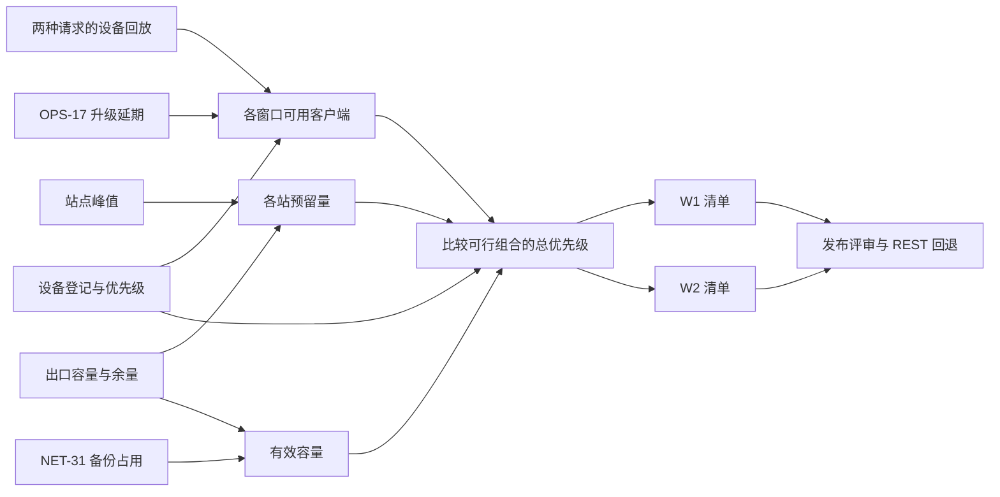

# Fleet 双窗口发布与成果合成

本试点从上一轮所有者接受的 gRPC 服务 `95b83e71ee9a37041b9918b5e8b797eebabf69c9` 接续。模拟运营方提交五份业务材料和任务说明，得到冻结基线 `567f84b7c64fd35ed1c19090dbeab14544a136ee`。模型收到的目标是为两个窗口交付经核对的发布计划和评审说明。普通 DSH 提供原生 Subagent、Workflow、Git 和项目贡献工具。所有输入也可由一个 Principal 读取。该配置验证原生协作路径，未挂载独立正式 Worker broker。[业务说明](../../fixtures/psvr/fleet-rollout/BRIEF.md) · [运行入口](../../scripts/pnwf/software/fleet-rollout/run.mjs)

## 为什么需要合成

单看收益会优先选 Dune。设备登记表预计它在 W1 后升级，但 OPS-17 将升级推迟至 W2 之后。旧客户端能解码缺省请求的三条记录，显式零值却只解出两条。单看出口额定容量，两轮都可安排 Alder 和 Birch，但 NET-31 占用了 W2 的两单位带宽。站点流量需要先取两个采样峰值中的较大值，再计入余量并向上取整。兼容名单、站点资源和业务权重最后才在窗口分配处汇合。[五份原始材料](../../fixtures/psvr/fleet-rollout)

下图是业务依赖。真实 Agent 数以实际 DSH 会话流为准。



| 窗口 | gRPC | 保留 REST | 已用 / 可用 | 优先级合计 |
| --- | --- | --- | --- | ---: |
| W1 | Alder、Birch | Cedar、Dune | 9 / 10 | 20 |
| W2 | Birch、Cedar | Alder、Dune | 8 / 8 | 17 |

独立判分器从确切 Git 提交取两个交付文件，核对净差异、四站分区、两种请求、容量与最优性。它枚举所有可行子集。评审文字自动检查文件与变更单引用，论证质量须阅读原稿。六项回归包括改变业务事实的反例：取消 NET-31 后 W2 恢复 Alder 与 Birch；取消 OPS-17 后 W2 改为 Alder 与 Dune。只选最高优先级的单站也会被拒绝。[判分器](../../scripts/pnwf/software/fleet-rollout/score.mjs) · [反例回归](../../scripts/pnwf/software/fleet-rollout/score.test.mjs)

## 自主协作的判据

分别记录是谁发起协作、有多少真实子会话、各自返回了什么、Principal 如何处理、交付物是否使用了这些结果。调用工具或登记贡献本身只证明相应动作。收到建议后若交付物已先行完成，要另记其时间顺序。独立完成但业务正确也是有效观测。只有业务目标进入真实提示，预制 Mock 步骤及独立判分留在宿主。

零付费 Mock 启动了一个 Principal 与三个独立的原生 DSH 子会话。客户端子会话交回三个兼容站点，网络子会话算出窗口容量 10 和 8，调度子会话算出四站的预留量和优先级。Principal 读回各自实测的中间文件，先后登记三项贡献和三份采纳决定，再用三个中间文件计算组合，提交 `5c35385f6156707a69ac7e16f365a2ca0ebca7bc`。20 笔合成请求，46.021 秒，自然退出。该结果验证协作链可以执行。[Mock 原始记录](../../research-evidence/pnwf-software/2026-11-19/fleet-rollout/mock/result.json)

## 真实业务提示样本

OpenCode Go 的 `deepseek-v4.1-flash` 从同一基线启动。一次 Principal 会话，自主启动子会话 0 个，项目贡献与采纳决定均为 0。它在序号 45–50 直接读五份运营材料和历史 Fleet 更正。随后自行写两项交付物，在序号 97 用临时 Node 程序从原始材料重新推导有效版本、带宽和优先级，枚举可行子集，核对清单。提交前后核对了 Git 状态，记录 `DELIVER` 后自然退出。[工具调用与回执](../../research-evidence/pnwf-software/2026-11-19/fleet-rollout/live/out/ROLLOUT/attribution/0.timeline.json)

独立程序从候选 `7c5cef3989b394b69191a43104c8fa8cdaa21bf2` 复算，两轮均为最优。人工阅读原稿也可追到 Dune 零值回放、延期单、W2 备份预留以及未选站点回退 REST 的理由。准入基线是已接受的服务，最新候选是供所有者评审的计划。实验没有执行部署。[评审原稿](../../research-evidence/pnwf-software/2026-11-19/fleet-rollout/live/rollout/REVIEW.md) · [发布清单](../../research-evidence/pnwf-software/2026-11-19/fleet-rollout/live/rollout/plan.json)

| 观测 | 脚本化 Mock | 真实业务提示 |
| --- | ---: | ---: |
| Principal / 实际子会话 | 1 / 3 | 1 / 0 |
| 已登记采纳决定 | 3 | 0 |
| 最优窗口分配 | 2/2 | 2/2 |
| 已对账请求 | 20 笔合成 | 14 笔真实 |
| 成对工具调用 | 16/16 | 27/27 |
| 会话耗时 | 46.021 秒 | 234.283 秒 |

真实会话共 320,861 tokens，fresh input 33,905、cache read 275,200、cache write 0、output 11,756，未决请求 0。此样本证明模型能独立合成跨来源成果。增加业务节点后，单个 Principal 仍可从同一工作区取得全部材料并穷举两个窗口，观察到的轨迹未提供跨 Agent 采纳或协作收益的证据。[会话与计量](../../research-evidence/pnwf-software/2026-11-19/fleet-rollout/live/result.json)

## 复算

在已安装依赖并构建的项目中，从仓库根目录运行以下命令。归档含带 SHA-256 清单的 Git bundle、各会话原始 DSH 流、工具归因和逐笔账本。复算不会调用模型。

```powershell
node --test scripts/pnwf/software/fleet-rollout/score.test.mjs
node scripts/pnwf/software/fleet-rollout/verify.mjs research-evidence/pnwf-software/2026-11-19/fleet-rollout/mock
node scripts/pnwf/software/fleet-rollout/verify.mjs research-evidence/pnwf-software/2026-11-19/fleet-rollout/live
```

要从头复现脚本化三子会话，可使用本机既有的 PNWF 镜像和全新目录。运行器只把接受的服务和公开运营材料交给参与者；额外判分与轨迹归因在宿主执行。

```powershell
$trial = Join-Path $env:TEMP ('fleet-rollout-' + [guid]::NewGuid())
node scripts/pnwf/software/fleet-rollout/run.mjs --mode=mock --run=$trial
```
