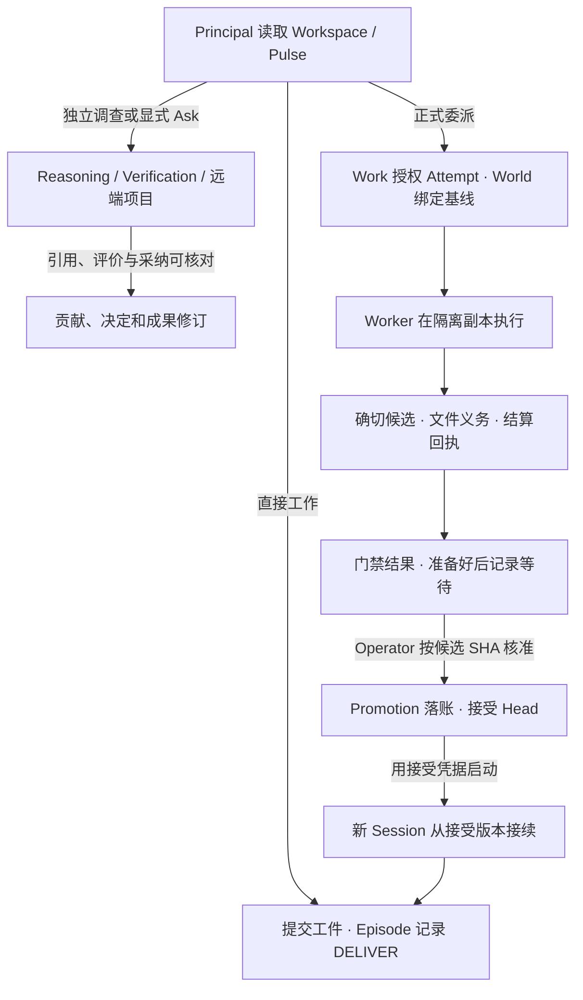

# Palimpsest 系统与证据来源

盘点基线为 `4e291944fd355adf3ff4fbb864401dfd1edb35d9`。该 Git 树的 `src/` 有 **65 个直接子目录、9 个顶层 TypeScript 文件，共 511 个 TypeScript 文件**，另含一份 SQL 迁移。下表为每个目录指定一个主要读者问题和一个取证入口。一个系统通常跨多个目录，例如正式执行要同时经过 Work、World、宿主、门禁和 Promotion。各能力在安装时按现有配置接入。[产品规划](PLAN.md) · [原语义所有者表](../../engineering/architecture/SEMANTIC-OWNER-MAP.md) · [安装与可选服务](../../../src/composition/install_contract.ts)

## 从任务走一遍

普通 DSH 由 Principal 读取项目现况，选择直接完成、发起独立调查、请其他项目回答，或委派隔离的正式 Worker。直接交付读取已提交工件，形成 Episode 结论。正式执行的 Plan 和 Task 定义工作，Attempt 固定基线、写范围与义务。Worker 在执行世界写入，产品复查候选并结算。只有需要正式接受时才走 Operator 与 Promotion。后续 Session 从接受版本取证。验证协议、模型调用、Git 作者和审批人各有自己的记录。下表的「入口」指向实现，浏览器的实际可达性见末节。[交互模型](../PALIMPSEST-INTERACTION-MODEL.md) · [Work 修订契约](../../engineering/WORK-REVISION-CONTRACT.md) · [接续路线图](../PROJECT-ROADMAP.md)



图中三条路径可以出现在同一项目的不同阶段。贡献是否被采用，须沿贡献记录查到决定与实际成果。上图的直接交付与正式接受各有自己的终态记录。

### 项目、意图与协作选择

| 模块与入口 | 状态从哪里来 | 用户看到什么 |
| --- | --- | --- |
| [project_workspace](../../../src/project_workspace/view.ts) | ProjectIR、项目日志、资产关联、open loops 的作用域读面 | 目标、有效决定、成果、未决事项。从关联返回原资产。 |
| [project_continuity](../../../src/project_continuity/service.ts) | 项目摘要、Episode 结论、工件观察与依据的聚合 | 这次从什么版本接续，交付引用指向哪个提交。 |
| [project_pulse](../../../src/project_pulse/types.ts) | 现有所有者读面派生的 Pulse，区分机械下一步与判断建议 | 谁需要行动、为什么、观察到了哪些作业。建议带「供判断」标记。 |
| [project_intent](../../../src/project_intent/proposal.ts) | 绑定依据的目标修订提案及其准入回执 | 哪个假设变化，提案与生效修订分别展示。 |
| [project_review](../../../src/project_review/types.ts) | 提案、操作员审阅元数据及调用既有权威端口的结果 | 谁审过什么、后续效果是否已落账。审阅元数据本身不改变 Head。 |
| [project_management](../../../src/project_management/service.ts) | 管理偏好、策略、评估和有界步骤 | 人希望系统多主动。操作仍须经原有服务授权。 |
| [project_operating](../../../src/project_operating/posture.ts) | Work Mode、姿态、活动及偏好历史 | 执行方式与管理介入分别展示，附可查的变更记录。 |
| [interaction](../../../src/interaction/collaboration.ts) | 本地协作、跨项目问答及委派服务对领域端口的组合 | 谁要求探索、检查或咨询，发给谁，收到何种产物。 |
| [advisor](../../../src/advisor/advisor.ts) | TaskProfile、依据和适用性形成的方案建议 | 何时建议 Focus 或 Explore，建议是否被采用。 |
| [recipes](../../../src/recipes/execution.ts) | 配方注册、实际就绪度、编译与执行结果 | 显示可用能力与实际调用，保留未具备条件的原因。 |
| [project_collaboration](../../../src/project_collaboration/need.ts) | 带依据的协作需求候选、准入与回执 | 为什么可能需要协作，另查是否产生执行。 |
| [reasoning_cell](../../../src/reasoning_cell/branch_settlement.ts) | Cell、调查分支、候选、主张与 frontier 的所有者 | 哪个分支带来独立判断，哪项主张被采纳。与写代码的 Attempt 分栏。 |
| [project_handoff](../../../src/project_handoff/lifecycle.ts) | 交接状态与投递记录，恢复时依赖可观察的状态 | 已送达、已消费、已据此行动、取消或中断分别显示。 |
| [project_contribution](../../../src/project_contribution/records.ts) | ProjectJournal 中可解析的贡献与评价记录 | 哪条贡献进入决定或成果，缺少关联时显示待查。 |
| [domain_outcome](../../../src/domain_outcome/service.ts) | 已定义的领域成果合同、硬约束、观测及项目日志 | 列出交付质量的实际判据、适用范围与缺项。 |

### Work、执行世界、结果与接受

| 模块与入口 | 状态从哪里来 | 用户看到什么 |
| --- | --- | --- |
| [schema](../../../src/schema/work_revision.ts) | 规范化模型、标识、摘要与版本化义务合同 | 允许改、必须改、必须存在、必须保留的文件表与规则摘要。 |
| [domain](../../../src/domain/project_head.ts) | ProjectIR、状态机、Head、授权与晋升准入规则 | 区分 Task、Attempt、项目修订与项目 Head。 |
| [state](../../../src/state/event_store.ts) | 按项目排序的事件链、授权与可重建投影 | 确切事件、序号、前序摘要、重放位置。 |
| [scheduler](../../../src/scheduler/scheduler.ts) | 从任务图和现态派生可执行集 | 哪项可执行，哪项在等依赖。与决定是否值得做分开。 |
| [tools](../../../src/tools/controller.ts) | ProjectController 编排命令、控制、门禁和 Work 图 | 每次命令的结果与拒绝，沿事件或回执访问落账事实。 |
| [work](../../../src/work/revision.ts) | Attempt、世界观察、完成检查、结算回执和报告 | 同时显示 Task 状态、Attempt 状态、写者归属、文件义务与回执阶段。 |
| [project_world](../../../src/project_world/admission.ts) | 基线签发、观察、兼容性、依赖、跨基线准入 | 绑定哪个世界、依据是否仍可用、接管或复用缺什么。 |
| [result](../../../src/result/subject.ts) | 由权威端口解析 Attempt Result 或派生候选，记录再物化来源 | 哪份结果可重新验证，哪份是另一基线上的派生结果。 |
| [continuation](../../../src/continuation/assessment.ts) | 当前基线与原基线比较、可行路径评估与准入 | 原样复用、再物化、重做或依据不足，以及各自的依据。 |
| [evidence](../../../src/evidence/gate_dsl.ts) | 证据图、门禁子句与作废语义，门禁结果进入事件链 | 哪一条门禁失败、依赖的证据，和协议判分分别呈现。 |
| [project_verification](../../../src/project_verification/status.ts) | 命名协议、目标引用、独立性与验证运行 | 验了哪个 SHA、用什么协议、何时有效、结果与缺项。 |
| [effects](../../../src/effects/promotion.ts) | Safe Actions、Ordarium 效果账与 Promotion 意图、结果、项目 Head | 核准的 candidate、原 Head、最终 Head、操作与事件 ID。 |
| [recovery](../../../src/recovery/recovery.ts) | 启动时对未完晋升等状态与效果记录的对账 | 已提交、尚待核对、可安全恢复的状态与依据。 |
| [execution_association](../../../src/execution_association/contract.ts) | 可信来源、启动与收尾观察、会话与 Attempt 的关联窗口 | 是否能把某个 DSH 会话绑定为执行者。跨宿主或缺失来源时保留未归属。 |

### 上下文、证据、经验与实验

| 模块与入口 | 状态从哪里来 | 用户看到什么 |
| --- | --- | --- |
| [context](../../../src/context/manifest.ts) | 清单、需求、检索、知识与既有结果的分发 | 哪份上下文被提供，是否实际读取或引用要另找观察。 |
| [proof_asset](../../../src/proof_asset/disclosure.ts) | 来源、选择器、材料、主张、核验、披露范围 | 可披露哪条证据，定位到原文或 blob，并显式标出不可见处。 |
| [external_assets](../../../src/external_assets/refs.ts) | 外部提供方、外部引用、导入、发布与桥接回执 | 外部原件、本项目引用、本地副本、发布对端分别标来源。 |
| [procedures](../../../src/procedures/admission.ts) | 方法内容、候选、准入、修订及存储 | 哪个版本的方法被提出、被接纳、在哪里适用。 |
| [institutional_learning](../../../src/institutional_learning/projection.ts) | 读取有依据的演化历史，投影干预并由既有组织记忆接口登记 | 经验来自哪次干预、后续是否复用。 |
| [experiment](../../../src/experiment/evaluation.ts) | 试验运行、验证器、指标与观察结果 | 冻结判分、复核、运行条件、比较范围各自可追溯。 |
| [telemetry](../../../src/telemetry/performance_table.ts) | 性能表与持久化观测 | 供选择和分析的历史统计。模型账单另读 Provider 账本。 |
| [trajectory](../../../src/trajectory/refs.ts) | Work、Reasoning、Proof、Workspace 的所有者引用，依据向量、分页与关系强度 | 可验证的历史关系、时间相邻、冲突和缺口。支持按历史依据阅读。 |

### 身份、运行、选择与架构

| 模块与入口 | 状态从哪里来 | 用户看到什么 |
| --- | --- | --- |
| [identity](../../../src/identity/refs.ts) | 跨模块共享的稳定标识和解析合同 | 可寻址的主体。同名、同头像不会合并两条身份。 |
| [continuity](../../../src/continuity/point.ts) | 可跨载体延续的 PersistentPoint 及存储 | 哪个长期身份延续，当前附着的运行与 Session 另取证。 |
| [architecture](../../../src/architecture/definition.ts) | 架构与 Agent 定义、预设、修订及摘要 | 当时配置了哪些定义。活动视图使用实际执行。 |
| [binding](../../../src/binding/freshness.ts) | 引用解析、编译、依据观察、合同有效性 | 配置绑定到哪个对象、判断时依据是否过期。 |
| [run](../../../src/run/configuration.ts) | Run 定义及配置 | 一次运行计划采用什么配置，实测信息从 Runtime/Host 读。 |
| [runtime](../../../src/runtime/observation.ts) | 载体、进程、运行身份、就绪性和观测 | 哪个进程被哪个 Host 看见、何时结束、退出原因。 |
| [runtime_scope](../../../src/runtime_scope/artifacts.ts) | 运行作用域、成员与来源依据 | 哪些激活共同参与本次运行，指回组织定义。 |
| [runtime_evolution](../../../src/runtime_evolution/assessment.ts) | 运行结构演化、评估和修订记录 | 某时采用的运行结构，以及调整的依据。 |
| [select](../../../src/select/tournament.ts) | 声明式选择和对比结果 | 选择了哪个候选，选择策略与实际表现各自有据。 |
| [allocate](../../../src/allocate/allocator.ts) | 分配策略及 telemetry 适配 | 哪个资源被分配给哪项工作，实际消费另行对账。 |

### 跨项目、组织与长期管理

| 模块与入口 | 状态从哪里来 | 用户看到什么 |
| --- | --- | --- |
| [federation](../../../src/federation/messaging.ts) | Peer、目录、线程、消息、联盟与承诺 | 请求送往哪个项目、对方怎样回应、承诺有无明确登记。 |
| [transport](../../../src/transport/envelope.ts) | 持久信封、游标与 pump | 发送、重投和确认。按信封去重，业务采纳另找证据。 |
| [boundary_memory](../../../src/boundary_memory/artifacts.ts) | 边界修订、成员、跨组织记忆及其来源 | 对方声明的版本、本地可见范围、采用的边界修订。 |
| [coordination](../../../src/coordination/participation.ts) | 参与、成员、激活和协调记录 | 谁以什么身份参加，和谁真正写结果分别查看。 |
| [institution](../../../src/institution/governed.ts) | 受治理的制度工件、修订及存储 | 哪套制度在此决定中有据可查。 |
| [organization](../../../src/organization/definition.ts) | 组织定义、资格、变换和来源 | 组织如何组成、谁具备哪些资格。 |
| [organization_dynamics](../../../src/organization_dynamics/dynamics.ts) | 从组织状态观察到的动态与服务评估 | 哪个组织变化值得查看，回到支撑它的事实。 |
| [organization_evolution](../../../src/organization_evolution/formalization.ts) | 组织变化候选、形式化、退役及记录 | 哪次结构变化已正式发生，哪次仍是候选。 |
| [organization_memory](../../../src/organization_memory/artifacts.ts) | 组织记忆工件与持久记录 | 保留了什么历史经验、哪个来源支持它。 |
| [campaign](../../../src/campaign/lifecycle.ts) | 多阶段活动、干预、生命周期及 next action | 长期行动走到哪里、待什么输入、最近为何改变方向。 |
| [monitor](../../../src/monitor/scope.ts) | 限定作用域的观测、tick、激活与投递记录 | 正在观察哪些活动、最近观测和触发结果。 |
| [attention](../../../src/attention/signals.ts) | 信号、路由规则与已处理标记 | 哪个角色需要获知什么，有无送达记录。 |

### 图、应用与宿主边界

| 模块与入口 | 状态从哪里来 | 用户看到什么 |
| --- | --- | --- |
| [graph](../../../src/graph/ir.ts) | Agent Graph IR、类型化引用和图补丁 | 架构/拓扑的结构与变更，另查对应的运行证据。 |
| [canvas](../../../src/canvas/doc.ts) | 由客户端持有的 Canvas 文档、布局和派生 | 可编辑设计草稿，保留草稿标记，回放走只读界面。 |
| [application](../../../src/application/projection_types.ts) | 应用读面、五种投影的实体、源依据与知识状态 | 用带 `species/kind/id` 的对象跨视图定位，显示可用性。 |
| [composition](../../../src/composition/trajectory.ts) | 安装时把所有者端口接到应用、执行、投影等消费者 | 确认本安装具备哪些观测与依赖。组装层不裁决结果。 |
| [adapters](../../../src/adapters/http/work.ts) | DSH 工具 profile、HTTP 路由与能力探测 | 通过可用入口读事实。领域权限仍在对应所有者。 |
| [deployment](../../../src/deployment/execution_world.ts) | 配置、Worker 端口、隔离世界、当前 Host 观察、启动与处置 | 环境、放置、可见作业、来源和最后观测时间。 |

## 对外入口、已交付界面与现有缺口

| 边界 | 本基线可核对的能力 | 方案如何接入 |
| --- | --- | --- |
| 包与顶层入口 | `index.ts`、`advanced.ts`、`product.ts` 分别承载主入口、专家 API、产品安装。`descriptor.ts` 描述插件，`install.ts` 组装。另有 procedures、project-intent、project-collaboration、institutional-learning 四个包子路径。 | 优先用现有读端口。`/product` 的 `revision.readReceipt` 与签权的 `revision.accept` 拥有不同职责。[包导出](../../../package.json) · [产品 API](../../../src/product.ts) |
| 命令行、DSH 与运行载体 | `cli.ts` 进命令路由，`cli_product.ts` 承载普通用户操作，`serve.ts` 提供 HTTP，`tui.ts` 提供终端双视图。正常 DSH 与专家 profile 暴露不同工具集。插件和隔离读写边界分别在两个 Host 包。 | 给 DSH/TUI 提供与网页一致的文本摘要及只读定位入口。打包 SDK、CLI 与 HTTP 权限分别核验。[CLI](../../../src/cli.ts) · [TUI](../../../src/tui.ts) · [工具面](../../../src/adapters/dsh/tool_profile.ts) · [DSH Host](../../../host/dsh/lib/runner.js) · [部署边界](../../../host/deployment/runtime/worker_fence.js) |
| Web 项目入口 | 装有 Workspace 时优先进入它。缺失时回退 Work。Workspace 已有 Overview、Work、Assets、Open Loops、History、Management、Monitor、Verification、External Assets 九页。 | 从 Overview 增加「项目历程」入口，先显示项目目标、接受版本、最近交付及待办，再按任务下钻。[导航与回退](../../../web/src/App.tsx) · [九页工作区](../../../web/src/project_workspace/ProjectWorkspaceView.tsx) |
| Web 工作图及深读 | Work 有 live/draft 与运行卫星、控制、门禁和晋升表单。MultiGraph 有 Work、Organization、Collaboration、Runtime、Reasoning 五种投影。Proof Vault 有来源、证据、资产、披露和 Explore。 | 保留现有专家入口。新阅读视图固定到历史对象并跳转相应页。其读取操作不复用会启动验证或改变状态的表单。[Work/Canvas](../../../web/src/App.tsx) · [MultiGraph](../../../web/src/MultiGraphView.tsx) · [Proof Vault](../../../web/src/proof_vault/ProofVaultView.tsx) |
| HTTP 与研究资料 | 已有 `/api/application/surfaces`、`/api/project/workspace`、`/api/project/history` 和五个 `/api/projection/*`。PNWF 账本、归因和冻结判分是实验资料。当前 HTTP 路由没有提供一个联结 Episode、回执、逐请求账本和同 SHA 复核的通用读面。 | 产品侧从各所有者组装最小只读视图。研究侧按白名单做本地归档导入。普通安装可缺少研究数据。[能力路由](../../../src/adapters/http/work.ts) · [项目路由](../../../src/adapters/http/project.ts) · [投影路由](../../../src/adapters/http/projections.ts) · [归因脚本](../../../scripts/psvr/session_attribution.mjs) |
| 外部事实与仓库基础设施 | Git 对象提供 commit/tree/blob。Ordarium 提供受控效果与耐久传输。DSH 和 Provider 分别给出会话动作与逐请求终态。版本化准入、回归、场景与封存由 `architecture/`、`tools/architecture/`、`test/`、`e2e/`、`fixtures/`、`scripts/`、`docker/`、`research-evidence/`、`release-evidence/` 等承载。 | 工程 CI、公开测试、业务判分、模型账本和产品接受按各自来源标注。一个 CI 绿灯不能替代全部判断。[Git 效果端口](../../../src/effects/git_port.ts) · [架构基线](../../../architecture/module-architecture.json) · [Bench 导航](../../engineering/README.md#bench-树) |

盘点可以从仓库根目录复核。第一条列出目录和顶层入口，第二条列出该树参与计数的源码。历史架构快照有自己的采集提交和统计口径。

```sh
git ls-tree --name-only 4e291944:src
git ls-tree -r --name-only 4e291944 -- src
```
